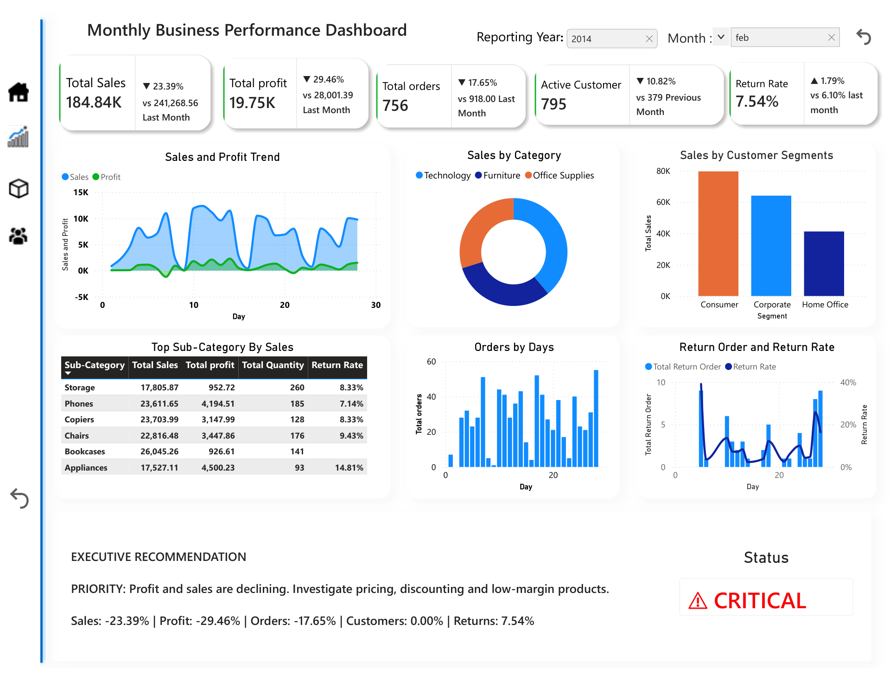
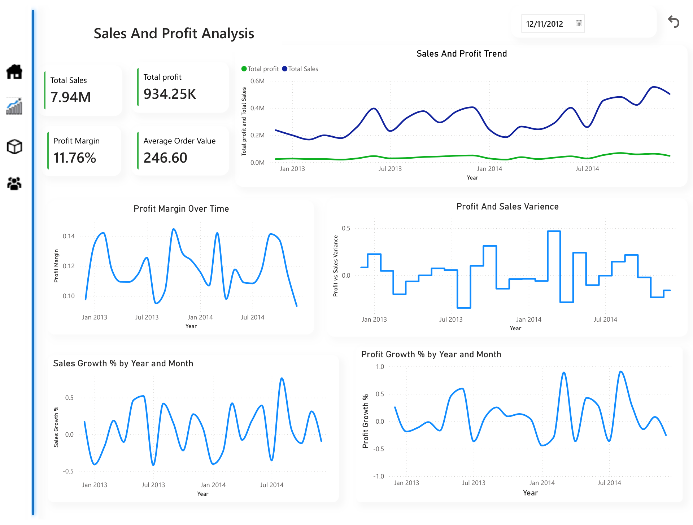
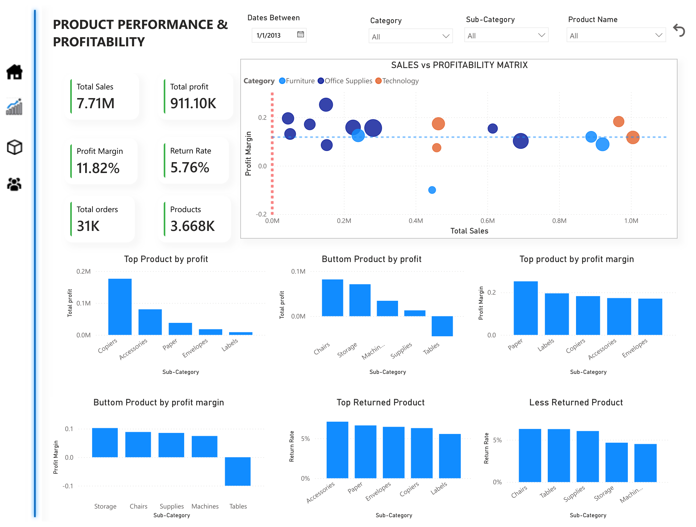
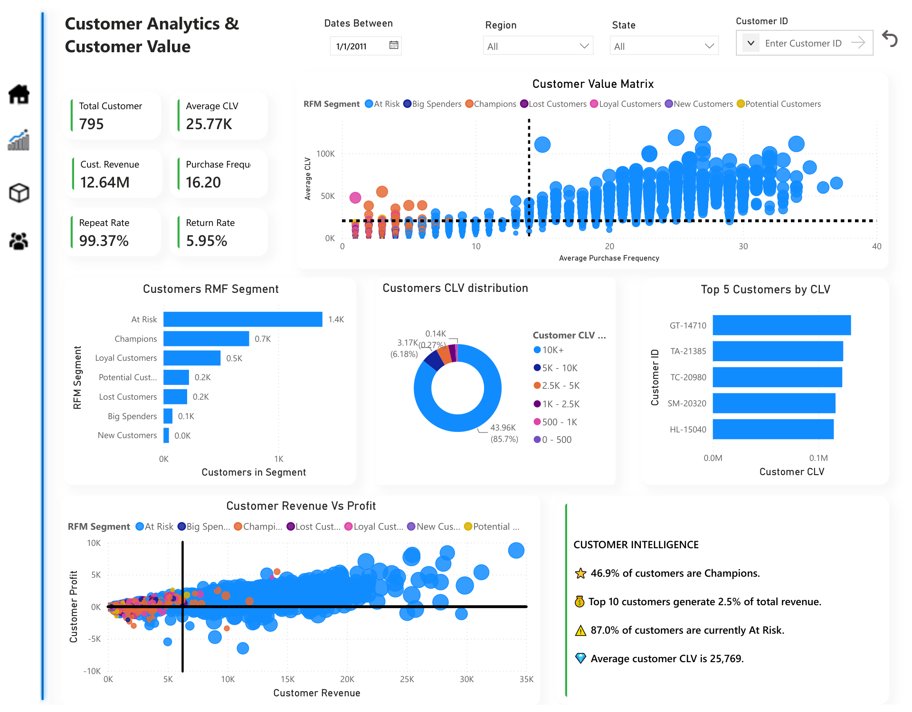
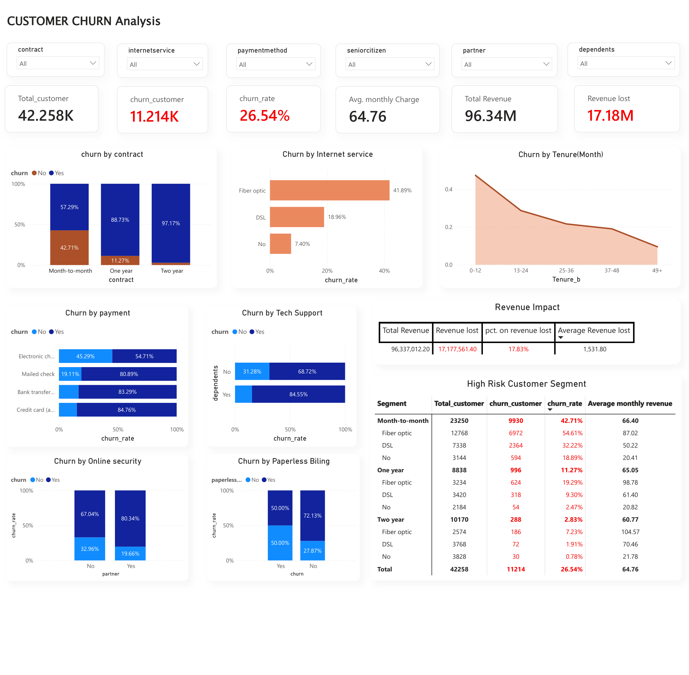
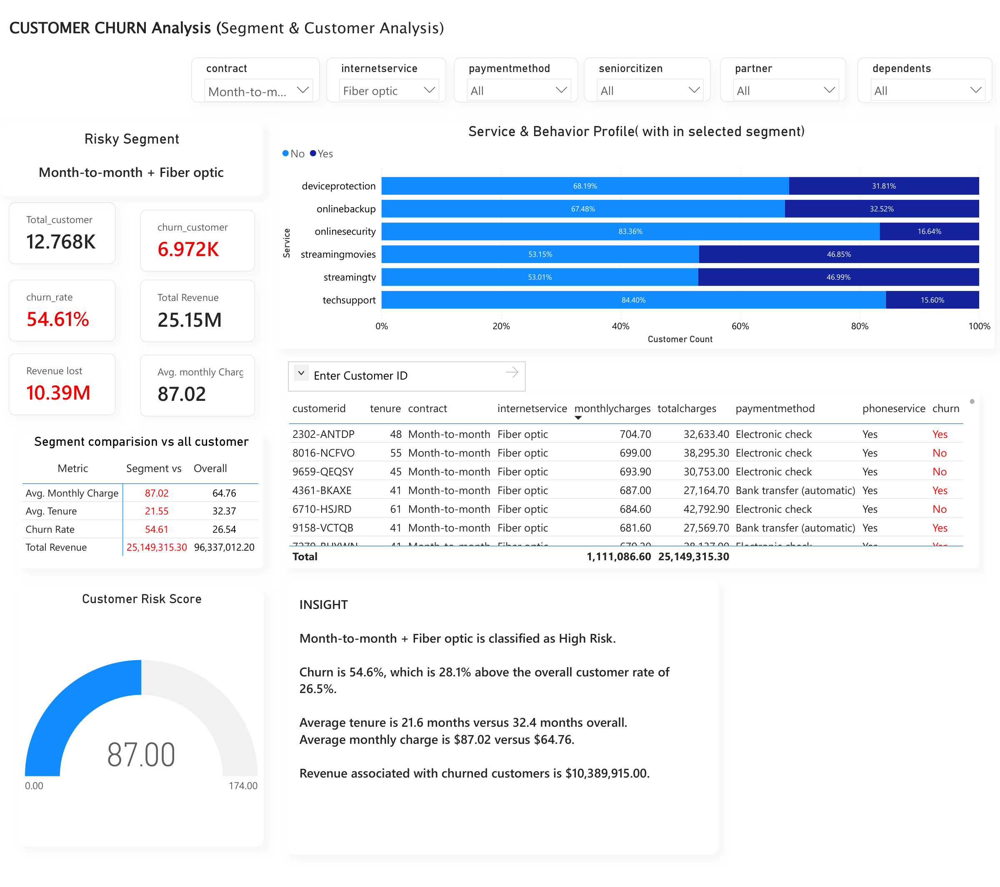

# 📊 Business Analytics & Customer Intelligence

An end-to-end **Business Intelligence and Data Analytics portfolio project** combining sales and profitability analysis, product performance, customer value analysis, and customer churn analytics using **SQL, Python, Power BI, and DAX**.

The project is organized into two complementary analytical modules. Each module answers a different set of business questions and turns raw data into insights that can support better business decisions.

---

## 🎯 Project Objectives

- Monitor business performance across sales, profit, orders, customers, and returns.
- Identify sales and profitability trends and investigate changes over time.
- Compare product and sub-category performance.
- Understand customer purchasing behavior, value, and repeat purchases.
- Analyze customer churn and identify factors associated with customers leaving.
- Quantify the revenue associated with churn.
- Identify customer segments that may benefit from targeted retention strategies.
- Communicate findings through interactive Power BI dashboards and business recommendations.

## 🧰 Tech Stack

| Technology | Purpose |
|---|---|
| **SQL** | Database setup, data quality checks, data cleaning, transformations, aggregations, churn analysis, and revenue analysis |
| **Python** | Supporting data processing and analysis |
| **Power BI** | Interactive dashboards and business intelligence |
| **DAX** | Measures, KPIs, and dashboard calculations |
| **CSV** | Source datasets |

---

# 🧩 Project Modules

## Module 1: Business Analytics & Customer Intelligence

This module focuses on overall business performance, sales, profitability, products, returns, and customer value.

### 1. Monthly Business Performance
Key metrics and analyses include:

- Total sales and total profit
- Total orders and active customers
- Return rate
- Sales and profit trends
- Sales by category and customer segment
- Top sub-categories
- Orders by day
- Return orders and return rate

### 2. Sales & Profitability Analysis

- Average order value (AOV)
- Total sales and total profit
- Profit margin
- Profit margin over time
- Profit-versus-sales variance
- Sales growth and profit growth

### 3. Product Performance & Profitability

- Sales versus profitability matrix
- Profit margin by sub-category
- Total profit by sub-category
- Return rate by sub-category
- Top- and bottom-performing product groups

### 4. Customer Analytics & Customer Value

- Customer count and customer revenue
- Average customer lifetime value (CLV)
- Purchase frequency and repeat rate
- Customer return rate
- Customer value matrix
- RFM segmentation
- CLV distribution and top customers by CLV
- Customer revenue versus profit

### Selected Business Analytics Findings

| Metric | Reported value |
|---|---:|
| Sales change | -23.39% |
| Profit change | -29.46% |
| Orders change | -17.65% |
| Return rate | 7.54% |
| Historical sales | Approximately $7.94M |
| Historical profit | Approximately $934K |
| Profit margin | Approximately 11.76% |
| Average order value | Approximately $246.60 |
| Average customer CLV | Approximately $25.77K |
| Repeat rate | Approximately 99.37% |

The customer analysis uses RFM segmentation to distinguish groups such as **Champions, Loyal Customers, At Risk, Lost Customers, Big Spenders, New Customers, and Potential Customers**.

> These figures are reported by the original Business Analytics dashboard. Confirm the date range, calculation definitions, and source data before comparing them with other reports.

### Dashboard Previews



*Monthly Business Performance*



*Sales & Profitability Analysis*



*Product Performance & Profitability*



*Customer Analytics & Customer Value*

---

## Module 2: Customer Churn Analysis

This module investigates customer churn using SQL-based data quality assessment, cleaning, analysis, and an interactive Power BI dashboard. It examines churn patterns, revenue impact, and higher-risk customer segments.

### Business Questions

- What proportion of customers have churned?
- Which contract types have the highest churn rate?
- How does churn vary by internet service and payment method?
- Is churn more common among newer customers?
- How do monthly charges and tenure differ between churned and retained customers?
- Which customer segments have elevated churn?
- How much revenue is associated with churned customers?

### SQL Workflow

```text
Raw Customer Dataset
        ↓
Database and Source Table
        ↓
Data Quality Assessment
        ↓
Data Cleaning and Transformation
        ↓
Cleaned Analytical View
        ↓
Churn and Revenue Analysis
        ↓
Customer Risk Segmentation
        ↓
Power BI Dashboard
        ↓
Business Recommendations
```

### SQL Components

| File | Purpose |
|---|---|
| `SQL/database.sql` | Creates the database and source table |
| `SQL/dataunderstanding.sql` | Assesses missing values, duplicates, categories, and data quality |
| `SQL/data_cleaning.sql` | Cleans and standardizes data and creates `cleaned_churn_data` |
| `SQL/analysis.sql` | Analyzes churn, revenue, tenure, and customer segments |

The data quality assessment reported **11 blank values in `TotalCharges`**, with no duplicate customer IDs or duplicate records detected in the checks documented in the original project README. The cleaning workflow handles blank `TotalCharges`, converts the field to a decimal type, trims text, and standardizes selected categories.

### Key Customer Churn Findings

| Metric | Reported value |
|---|---:|
| Total customers | 7,043 |
| Churned customers | 1,869 |
| Overall churn rate | 26.54% |
| Average monthly charge | $64.76 |
| Average tenure | 32.37 months |
| Revenue associated with churn | Approximately $2.86M |
| Reported revenue loss percentage | 17.83% |

### Churn by Contract Type

| Contract | Churn rate |
|---|---:|
| Month-to-month | 42.71% |
| One year | 11.27% |
| Two year | 2.83% |

### Churn by Internet Service

| Internet service | Churn rate |
|---|---:|
| Fiber optic | 41.89% |
| DSL | 18.96% |
| No service | 7.40% |

### Churn by Payment Method

| Payment method | Churn rate |
|---|---:|
| Electronic check | 45.29% |
| Mailed check | 19.11% |
| Bank transfer (automatic) | 16.71% |
| Credit card (automatic) | 15.24% |

### Other Churn Signals

- **Early lifecycle:** customers with 0–12 months of tenure have a reported churn rate of 47.44%.
- **Online Security:** customers without Online Security have a reported churn rate of 41.77%, compared with 14.61% for customers with the service.
- **Senior citizen segment:** the reported churn rate is 41.68%, compared with 23.61% for non-senior customers.
- **Highest-risk segment:** the combination of month-to-month contracts and Fiber Optic service has a reported churn rate of 54.61%.

These are associations observed in the analyzed dataset; they do not, by themselves, establish that any one factor causes churn.

### Dashboard Previews



*Page 1 — Overall customer churn, revenue, tenure, services, contracts, and payment methods.*



*Page 2 — High-risk segment analysis, segment-versus-overall comparisons, customer details, and risk indicators.*

---

# 💡 Combined Business Value

Together, the two modules support a wider view of business performance and customer intelligence:

| Analytical area | Business questions supported |
|---|---|
| Sales performance | Are sales and orders increasing or declining? |
| Profitability | Which products and categories contribute most to profit? |
| Returns | Which products or categories have higher return rates? |
| Customer value | Which customers generate the most value? |
| RFM segmentation | Which customers are recent, frequent, high-value, or potentially at risk? |
| Churn analysis | Which customer groups are more likely to leave? |
| Revenue impact | How much revenue is associated with churn? |
| Business recommendations | Where could retention or performance improvement efforts be prioritized? |

## Business Recommendations

Recommendations suggested by the analyses include:

1. **Investigate declining performance.** Review sales, profit, and order trends to identify areas needing attention.
2. **Review product and category performance.** Investigate low-margin products and sub-categories with high return rates.
3. **Use customer value segments.** Tailor engagement to customer groups identified through RFM and CLV analysis.
4. **Strengthen early customer retention.** Review the customer journey during the first year.
5. **Investigate high-churn groups.** Pay attention to month-to-month customers and the month-to-month plus Fiber Optic segment.
6. **Evaluate contract options.** Test whether appropriate long-term contract offers improve retention.
7. **Review payment experience.** Investigate why electronic-check customers have higher observed churn before testing alternative payment options.
8. **Measure outcomes.** Track relevant KPIs over time to assess whether business actions improve performance.

These recommendations are hypotheses for business investigation and testing, not guaranteed outcomes.

---

# 🗂️ Suggested Repository Structure

The following is a suggested combined structure. Adjust paths to match the actual files in your repository.

```text
business-analytics-customer-intelligence/
│
├── Dashboard/
│   ├── Business Analytics & Customer Intelligence Dashboard.pbix
│   └── customer-churn-dashboard.pbix
│
├── Dataset/
│   ├── cleaned_churn_data.csv/
│   └── cleaned_sales.csv/
│
├── SQL/
│   ├── database.sql
│   ├── dataunderstanding.sql
│   ├── data_cleaning.sql
│   └── analysis.sql
│
├── Python/
│   └── 
│
├── Snaps/
│   ├── dashboard_page_1.png
│   ├── dashboard_page_2.png
│   ├── dashboard_page_3.png
│   └── dashboard_page_4.png
│   ├── customer-churn-analysis-page-1.png
│   └── customer-churn-analysis-page-2.png
│
├── README.md
└── .gitignore
```

**Note:** This tree is illustrative, not a verified inventory of the combined repository. Keep your actual filenames and folders, and update the preview image paths to match them. GitHub paths are case-sensitive, so `Snaps/` and `snaps/` are different directory names.

Do not commit local virtual environments such as `venv/`. Add them to `.gitignore`.

---

# 🚀 Getting Started

## 1. Clone the repository

```bash
git clone <your-repository-url>
cd <your-repository-folder>
```

Replace the placeholders with your actual Git repository URL and folder name.

## 2. Review the datasets

Locate the source datasets for each module under `Dataset/`. The Business Analytics and Customer Churn modules use different analytical datasets.

## 3. Run the churn SQL workflow

Using a compatible SQL database:

1. Run `SQL/database.sql` to create the database and source table.
2. Load the customer churn dataset into `churn_data`.
3. Run `SQL/dataunderstanding.sql` to inspect data quality.
4. Run `SQL/data_cleaning.sql` to create `cleaned_churn_data`.
5. Run `SQL/analysis.sql` to reproduce the documented churn analysis.

Review the SQL scripts and adjust database-specific syntax or file paths if necessary.

## 4. Open the Power BI reports

Open the relevant `.pbix` files in Power BI Desktop. Configure data-source paths and credentials for your environment, then refresh the data as needed.

## 5. View the dashboard previews

Ensure the screenshot files exist at the paths used in this README. If your folder names differ, update the Markdown image links accordingly.

---

# 🧠 Skills Demonstrated

- SQL database creation and querying
- Data quality assessment and cleaning
- Missing-value and duplicate checks
- Data transformation and analytical views
- KPI development and business metrics
- Sales and profitability analysis
- Product and return analysis
- Customer segmentation using RFM
- Customer lifetime value (CLV) analysis
- Churn-rate and revenue-impact analysis
- Risk-segment analysis
- Power BI dashboard design
- DAX-based calculations
- Exploratory and diagnostic business analysis
- Insight communication and business recommendations

---

# 📌 Project Outcome

This portfolio project demonstrates an analytics workflow that moves from data preparation to analysis, visualization, and decision support.

**Business performance → Product analysis → Customer intelligence → Churn and revenue risk → Business recommendations**

The Business Analytics module examines sales, profit, returns, products, and customer value. The Customer Churn module examines retention patterns and customer groups with elevated churn. Together, they demonstrate how SQL, Python, Power BI, and DAX can support practical business intelligence.

## 👤 Author

**Anish Tiwari**

**Focus:** Data Analytics | SQL | Python | Power BI | DAX | Business Intelligence

---

*Metric values in this README are carried over from the two original project READMEs. Validate their definitions, time periods, and calculations against the source datasets and dashboards before presenting them as directly comparable.*
